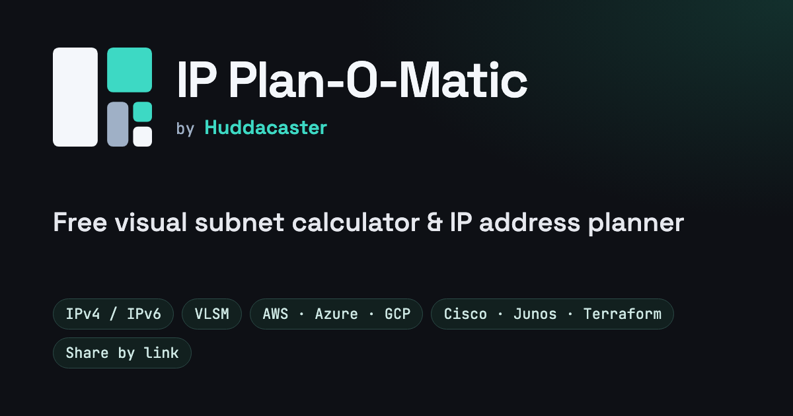

# IP Plan-O-Matic — Free Visual Subnet Calculator & IP Address Planner

**▶ Use it now: https://crockerfeller.github.io/IP-Plan-O-Matic/**

IP Plan-O-Matic is a free, browser-based **subnet calculator**, **VLSM calculator** and **IPv4/IPv6 address planner**. Lay out a whole network plan visually: divide a block into subnets with a click, join them back together, label each with a name, VLAN and status, see it all on a color-coded address map, then export router or Terraform config. Nothing to install, no account, no server. Your plan lives in the page link, and the app works offline.

## Features

- **Visual IPv4 subnetting:** divide and join subnets; see network, broadcast, usable range, gateway, netmask, wildcard, binary and host count.
- **IP assignments:** click a subnet's host count to assign single addresses (servers, printers, firewalls) with a name, MAC and notes, see the platform's reserved addresses, and track how full each subnet is. Paste several at once or import a CSV of addresses; export them as CSV, JSON or a sheet in the Excel file.
- **Address map:** the base network as a grid of squares, colored by status or VLAN. Click a subnet to jump to its row.
- **Several base networks in one plan:** HQ, branches and cloud VPCs side by side, each with its own platform rules. Overlapping base networks are refused.
- **Add by CIDR:** type `10.0.5.0/24 Servers` to carve out an exact subnet, or a range outside the plan to add a new base network.
- **Undo / redo:** every change, with Ctrl+Z / ⌘Z and Ctrl+Shift+Z / ⇧⌘Z.
- **Keyboard shortcuts:** select a row with the arrow keys, then D divides, J joins and S sets status.
- **VLSM auto-planner:** list networks with host counts (plus optional VLAN and growth headroom). Each one is placed best-fit, largest first. Replace the plan, or fill only the free space around the subnets you already have. Add availability zones to repeat every tier in each AZ.
- **Network wizard:** the button follows the Platform. On Standard (on-prem), tick the networks a site needs (management, servers, staff, Wi-Fi, voice, guest, IoT, cameras, DMZ…) with device counts and get each sized, named and given a VLAN ID. On Azure, AWS, Google Cloud or Oracle Cloud, pick the cloud services you need and get a VNet / VPC / VCN, or a hub and spokes, with correctly named, correctly sized subnets (Google Cloud: per region, with GKE secondary ranges and private services access; Oracle: hub and spokes joined by a DRG).
- **Cloud-aware:** AWS VPC, Azure VNet, Google Cloud VPC and Oracle Cloud (OCI) VCN reserved addresses and minimum subnet sizes.
- **Overlap checker:** test your IPv4 and IPv6 plans against existing networks, VPN peers and VPCs.
- **Compare plans:** see what changed between a saved plan, a plan link or a cloud's network list and the current plan (subnets added, removed, split or joined, and names, VLANs or statuses changed), and copy it as Markdown for a change review.
- **Route summarization:** collapse a list of IPv4 or IPv6 routes into the fewest blocks and find the covering supernet.
- **Address info:** IPv4 and IPv6: RFC 1918, CGNAT, ULA, link-local, documentation, multicast and other special ranges, plus the in-addr.arpa or ip6.arpa reverse zone.
- **IPv6 planner:** split prefixes by bit or nibble; give each prefix a name, VLAN, status and notes; auto-plan by count (e.g. `Sites, /56, 12`); generate a random ULA /48.
- **Export:** Cisco IOS / IOS-XE, Arista EOS, Juniper Junos, MikroTik RouterOS, FortiGate, Palo Alto PAN-OS, pfSense (a PHP script that adds the VLANs), OPNsense (an API script for VLANs and Kea DHCP), Ubiquiti UniFi (an API script) and EdgeRouter (EdgeOS), Terraform (AWS, Azure, GCP, OCI), Bicep, CloudFormation, an Azure CLI script for PowerShell (Azure exports add route tables through Azure Firewall and, optionally, an NSG per subnet), Ansible, NetBox and phpIPAM imports, Excel, CSV, JSON, Markdown and HTML tables, a PNG or SVG image of the address map and subnet table, with optional DHCP pools and IPv6 interface addresses. Import JSON or CSV, or your existing networks from the AWS, Azure, Google Cloud or Oracle Cloud command line.
- **Save and share:** the whole plan is stored in a compact URL, so you can bookmark it or send it. You can also save named plans in your browser and export them all as a backup. Your working plan is kept automatically.
- **Works offline:** installable as an app (PWA); after the first visit it runs without a connection.
- Light and dark themes, works on phones, print-friendly. Checked for accessibility (WCAG 2.2 AA rules with axe-core) in both themes.

## Accurate and private

- **No ads, no tracking, no cookies, no sign-up.** Your plan stays in your browser.
- **Content Security Policy:** only the site's own script files can run, so even a crafted plan link can't run code.
- **Tested in Chrome, Safari (WebKit) and Firefox:** the math is checked against Python's `ipaddress` library on hundreds of random IPv4 and IPv6 networks, and every export is checked by the tool that would use it (`terraform validate`, `bicep build`, `cfn-lint`, `php -l`, `shellcheck` and more). See [`tests/`](tests/).

## Guides

Short references built from computed data, in [`learn/`](https://crockerfeller.github.io/IP-Plan-O-Matic/learn/): CIDR cheat sheet, host counts, VLSM, private ranges, IPv6 subnetting, subnet sizing for AWS, Azure, Google Cloud and Oracle Cloud, a page for every subnet size from /8 to /32 plus IPv6 /48, /56 and /64, and a [subnetting practice](https://crockerfeller.github.io/IP-Plan-O-Matic/learn/subnetting-practice.html) quiz that checks each answer and shows the working. Rebuild them with `python3 tools/build_learn.py` and commit the result; CI runs `python3 tools/build_learn.py --check` and fails if the committed guides don't match the generator.

## Who it's for

Network engineers, sysadmins, cloud architects, homelabbers, and CCNA / Network+ students learning subnetting.

## Run locally

There's no build step: `index.html` (the page), `app.css` and the app's scripts in [`js/`](js/), one file per area (math and state in `core.js`, the plan table, VLSM, wizards, tools, export formats, import, IPv6, and `main.js` last). They're plain scripts, not modules, loaded in order and sharing one scope, so a downloaded copy works opened straight from disk. Open `index.html` in a browser. (`package.json` is only for development tools: `npm install`, then `npm run lint` runs ESLint and `npm run typecheck` checks `js/` with TypeScript, using JSDoc hints where needed. The site doesn't use them.) Offline support (`sw.js`, `manifest.webmanifest`) needs it served over `https://` or `http://localhost`, for example `python3 -m http.server`. A copy run straight from the repo is a **dev build**: it shows "dev" instead of a build number.

## Versions and deploys

Every push to `main` runs [`.github/workflows/deploy.yml`](.github/workflows/deploy.yml): the test suites run against the built site, every export is checked with its real tool, and only if all of that passes is it deployed to GitHub Pages. Pull requests run the tests without deploying.

The build (`python3 tools/build_site.py _site`) stamps `index.html`, `js/main.js` and `sw.js` with the commit hash and date (the page asks for `app.css` and every `js/` file with the build in `?v=`, so a new page never runs with an old cached script), writes `version.json`, and packs `IP-Plan-O-Matic.zip`. The page shows its build above the Reload button and in the footer. It checks `version.json` now and then, and turns Reload green when a newer build is live. A downloaded copy has **Check for updates** in the footer, which compares it with the live site and offers the new zip.

## What's new and feedback

[`CHANGELOG.md`](CHANGELOG.md) lists what changed, by date; the app's footer links to it as **What's new**. CI fails a push that changes the app or the guides without a line there; put `[no changelog]` in a commit message for changes nobody would notice. Found a problem or have an idea? Use [Report a problem](https://github.com/Crockerfeller/IP-Plan-O-Matic/issues/new?template=bug.yml) or [Suggest a feature](https://github.com/Crockerfeller/IP-Plan-O-Matic/issues/new?template=feature.yml) (the footer has both links, and Report a problem fills in your build number), or message [@wangooroo on X](https://x.com/wangooroo).

## Contributing

[`CONTRIBUTING.md`](CONTRIBUTING.md) explains how the code is laid out, how to run every check, and how to add an export format.

## License

[MIT](LICENSE): you're free to use, change and share the code, including commercially, as long as the copyright notice stays with it. The license covers the code, not the name: if you publish a modified version, please give it a different name than "IP Plan-O-Matic".

## Support

IP Plan-O-Matic is free. If it saved you time, you can tip:

- **X Money:** in the X app, Money → Send → `@wangooroo`
- **Venmo:** [@Crockerfeller](https://venmo.com/u/Crockerfeller)
- **Ko-fi:** [ko-fi.com/crockerfeller](https://ko-fi.com/crockerfeller)

Or follow [@wangooroo on X](https://x.com/wangooroo).

---

By Huddacaster, a subsidiary of Crockerfeller Industries © 2026
